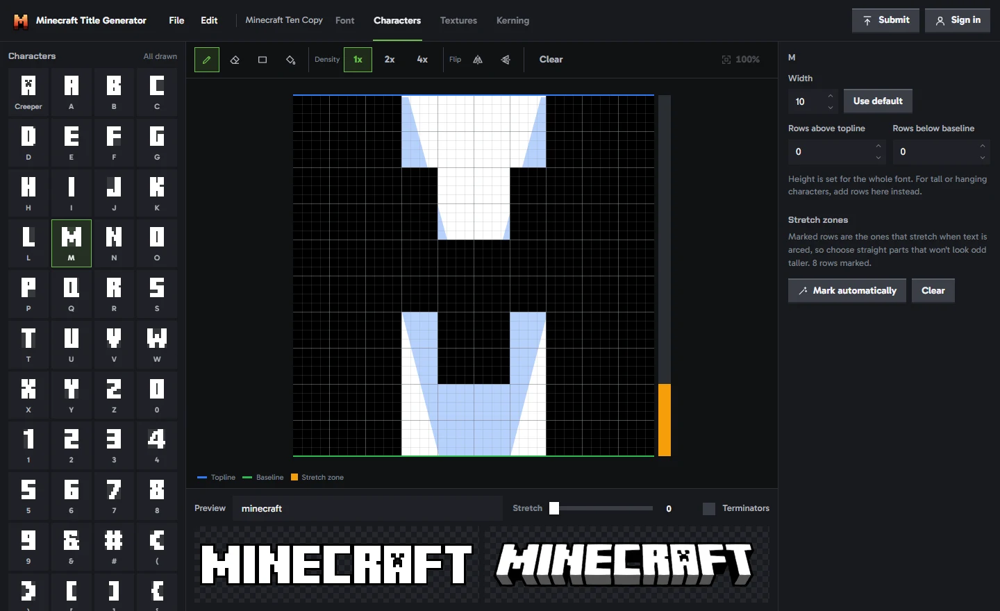

# Fonts

## Making a font



Fonts are made in the [font editor](https://mctitlegenerator.com/font-editor/). Start from scratch, or import a TTF, OTF or WOFF font, or an `ascii.png` from any resource pack. Draw the characters, set the kerning, then press Submit in the top bar. You can also download the font's JSON and send it on the [submit page](https://mctitlegenerator.com/submit/).

Set the name, ID, authors and description in the editor's Font tab. If your font is made from another font in the generator, set it as Based on so its authors are credited too.

### Requirements

- A new font needs every default character drawn: `a` to `z`, `0` to `9`, `& # ( ) [ ] { } / \ ? ! . : - ' + = < > % ^ * ~ , ; _ $ £ € @`, the opening quote, and the left and right line terminators. The Creeper A is optional.
- A font with both cases needs a capital and a lowercase version of every letter.
- Fonts are 8 to 128 pixels tall, with up to 400 characters.
- The ID is up to 40 lowercase letters and numbers, with single hyphens between words, like `my-font`. It cannot be used by another font.
- Kerning has to stay close to what the editor's Kerning tab suggests. Kerned pairs cannot push their characters into each other.
- A [strip type](textures.md#strip-types) with no height has to line up with the font's height. Strip offsets are set in the editor's Textures tab.
- A font made from someone else's files, like a font downloaded from another site, needs links to the original and to its licence. A font that only looks like something else, like a logo, does not.

### Variants

A variant is another version of a font already in the generator, listed under it with its own textures, eg the same letters for another alphabet. Choose "A variant" on the submit page and pick its font. Variants do not need every default character.

### Textures, overlays and strips

A font gets a plain flat texture to start with. You can send up to 24 [textures, overlays](textures.md) and [strips](textures.md#strip) along with it, and a flat texture to replace the plain one. Download the blank texture and blank strip from the editor's Textures tab, and paint over those.

Mark one texture as primary, which is what top and small lines start with, and one as secondary, which is what bottom lines start with. Without a secondary, bottom lines use the primary, and without a primary, every line starts flat.

## Folder

Each font has a folder in `public/fonts`, named after its ID.

| File | Holds |
| --- | --- |
| `font.png` | The font sheet |
| `textures.json` | The font's [textures and overlays](textures.md) |
| `textures/` | `flat.png`, the template every texture is painted over, and the textures |
| `overlays/` | The overlays |
| `thumbnails/` | Generated thumbnails |
| `forced-overlay.png` | Only for fonts with `overlay` set, drawn over every texture that is not one of the font's own |
| `variants/` | One folder per variant |

There are two kinds of variant folder:

- A variant with `inherits` set keeps its characters in its parent's `font.png`, after the parent's own, and uses the parent's textures. Its folder only holds its thumbnails.
- Any other variant is a whole font of its own, with every file above.

## fonts.json

`public/fonts/fonts.json` lists every font. A variant goes in its parent's `variants` list, and uses the same keys.

| Key | Default | Does |
| --- | --- | --- |
| `id` | | The font's ID and folder name |
| `name` | The ID in title case | The name shown in the generator |
| `authors` | | Everyone who made it |
| `description` | | Shown in the font's info |
| `basedOn` | | The ID of the font it was made from, credited alongside it |
| `source`, `licence` | | Links to the original files and their licence, for a font made from someone else's files |
| `order` | The default characters | The characters in `font.png`, in reading order. For an `inherits` variant, only its own characters |
| `multicase` | `false` | Keeps capitals and lowercase apart. Without it, text is lowercased and `A` is the Creeper A |
| `kerning` | | Pairs grouped by how many pixels they are pulled together, eg `{ "2": ["ab", "cd"] }` |
| `spaceWidth` | `8` | The width of a space, when the font has no space character |
| `characterSpacing` | `0` | Extra spacing between characters |
| `depth` | `22` | How deep the letters are |
| `border` | `2` | How thick the outline is |
| `height` | The letter height plus the outline | The height of a row of text |
| `strips` | | The [strip types](textures.md#strip-types) the font uses, as IDs or `{ "id", "offset", "layer" }` |
| `terminatorSpace` | `false` | Puts a space between the line terminators and the text |
| `terminatorSpaceWidth` | `spaceWidth` | The width of that space |
| `forcedTerminators` | `false` | Always draws the line terminators |
| `autoBorder` | `false` | Draws one outline around the whole word, filling the gaps between letters |
| `flat` | `false` | Keeps bottom lines as deep as the rest |
| `overlay` | `false` | The font has a `forced-overlay.png` |
| `allFaces` | `false` | Shows the inner and side faces. `"fade"` shows them faded |
| `layerDepth` | Stacked | `"independent"` makes each depth layer its own slab |
| `preview` | `"abc"`, or `"ABC"` with `multicase` | The text in the thumbnails |
| `inherits` | `false` | For variants, see above |
| `editor` | | Settings the font editor uses when opening the font |

```json
{
  "id": "minecraft-five-bold",
  "authors": ["Ewan Howell"],
  "depth": 16,
  "terminatorSpace": true,
  "variants": [
    {
      "id": "minecraft-five-bold-cyrillic",
      "name": "Cyrillic",
      "authors": ["xllifi"],
      "depth": 16,
      "terminatorSpace": true,
      "order": "😳0123456789&#()[]{}/\\?!.:-😩'+=<>%^*~,;_$£€@┫┣ёіїабвгдежзийклмнопрстуфхцчшщъыьэюяґғқңүұһәө₽",
      "preview": "абв",
      "editor": { "width": 32, "grid": 2 }
    }
  ],
  "editor": { "width": 32, "grid": 2 }
}
```

In `order`, `😳` is the Creeper A, `😩` is the opening quote, and `┫` and `┣` are the left and right line terminators.

## font.png

The font editor makes this for you, but it can be edited by hand. It has to be fully opaque.

- Full rows of red (`#ff0000`) split the sheet into rows of characters, with one along the top and one along the bottom.
- Columns of red split each row into cells, one per character, read left to right then top to bottom. Each cell's width is that character's width.
- A green (`#00ff00`) pixel in the first column of a row marks its baseline, and a blue (`#0000ff`) one marks its top line. Without them, the baseline is the bottom of the row and the top line is the top. Every row has to be the same height between the two, but characters can reach above the top line or below the baseline.
- Black pixels are the character, and white pixels are empty.
- Grey pixels set how deep that part of the character is: the lighter the grey, the shallower. A font with more than one shade has layers.
- Green pixels in the red column to the right of a cell mark the rows of that character that stretch.

When `order` is the default, one extra cell after the rest is the space character.

## Adding a font with a pull request

In the font editor, File > Export downloads the font's `font.png` and blank `flat.png`, to put in its folder. These scripts help when working on a font by hand:

| Command | Does |
| --- | --- |
| `npm run convert -- <font file or name>` | Makes `font.png`, a flat template and a fonts.json entry from a font file or an installed font, in a new folder named after it |
| `npm run template -- <font>` | Makes the font's flat template from its `font.png`. Add `--force` to replace the one it has |
| `npm run mark -- <font>` | Marks which rows of each character stretch |

Then make its thumbnails and open the pull request, as in the [README](../README.md#submitting-with-a-pull-request).
